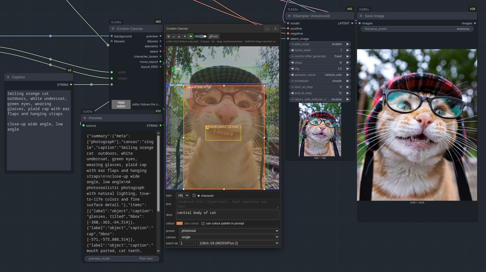

# ComfyUI-CordonCanvas

Canvas bounding-box editor for ComfyUI that builds MOSS-Image layout prompts, empty latents and box conditioning.



## Install
```bash
cd ComfyUI/custom_nodes
git clone https://github.com/cicalooo/ComfyUI-CordonCanvas
```
Restart ComfyUI. Uses the classic (LiteGraph) frontend.

## Nodes
**Cordon Canvas**
- Inputs: `background` (image, optional), `bboxes` (boxes / array / MOSS layout JSON, optional), `width`, `height`, `caption`, plus dock-only `style_preset`, `canvas`, `batch_size`, `latent_type`.
- Outputs: `preview`, `bboxes`, `elements`, `latent`, `character_boxes`, `moss_layout` (native `abs_centralized` JSON → text encoder), `layout_1000` (portable 0–1000 layout).

**Cordon Latent Upscale** — latent upscale snapped to a multiple; outputs latent, width, height.
**Cordon Inject Noise** — tops up noise at a two-pass sigma handoff.

## Editor controls
- Drag empty: new box · drag box: move · handles: resize · Shift/Ctrl+drag: new box over others
- Alt+click: cycle overlapping · Del/right-click: remove · Esc: deselect
- ⊘ boxes (end of toolbar): bypass all boxes → `moss_layout`/`layout_1000` become caption + style sentence only (boxes kept in the editor, shown dimmed)
- Wheel: zoom (to 16×) · middle-drag or Space+drag: pan · double-click empty: fit · Ctrl+wheel: graph zoom

## Style presets
`none`, `photo` (default), `3d render`, `2d art`. Each leads the caption with a medium statement (e.g. "A real-world photograph captured with a camera."), appends concrete medium cues and sets one `summary.meta` tag (`photograph` / `3d render` / `illustration`). With `photo`, the dock **focus** option (`shallow depth of field`, `full focus`, `moderate`, `wide-angle`, `telephoto`, `macro`) swaps the depth-of-field clause for a matching camera phrase. All earlier preset names still load and map to the nearest of the three.

## Notes
- `relative_1000` (used by `layout_1000`) is a CordonCanvas convention, not an official MOSS coordinate space; feed `moss_layout` to the encoder.
- Text boxes use the official `{"label":"text","text":…}` item and additionally quote the literal in the caption (e.g. `The text "SALE": bold red letters`) for more reliable rendering.

## License
Apache-2.0 — see [LICENSE](LICENSE).
